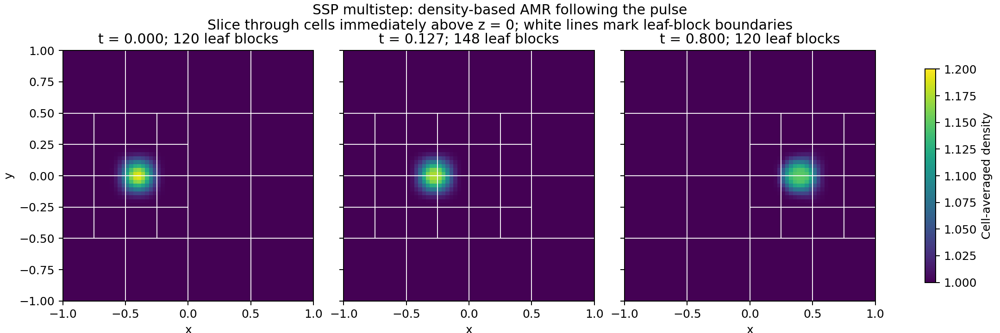

# RHS efficiency: density-refined advected pulse

This benchmark compares `SSP_MULTISTEP` directly with ordinary `RK3` using the
same executable, initial fields, density refinement rule, CFL parameter, and
final time. It measures RHS evaluations per simulated time and weights those
evaluations by the number of active interior cells. Both methods refine and
coarsen as the pulse moves. The earlier AMR rebootstrap reference is a separate
comparison; this benchmark's control uses three-stage RK3 at every step.

## Problem and acceptance criteria

The `AMR_ADVECTION` initializer transports a compact smooth density pulse at
velocity `(1,0,0)` on `[-1,1]^3`, with constant pressure `0.01`, gamma `5/3`, and
gravity off. The background density is 1 and the peak density is 1.2.
Initialization and error analysis use exact cell averages. Default settings:

| Setting | Value |
|---|---|
| Mesh | AMR, `min_level=1`, `max_level=3`, `unigrid=off` |
| Refinement criterion | Density greater than 1.005, up to level 3 |
| Surrounding mesh | Native refinement buffer and 2:1 neighbor nesting |
| CFL | 0.4 |
| Final time | 0.8 |
| Contact steepening | Off |
| Hard timestep cap | None |
| Execution | One CPU locality and one HPX worker; methods run sequentially |
| Silo output | Initial state and every regrid boundary |

Level 0 is the single root block. Once it splits, none of it remains a leaf;
level 1 is therefore the coarsest possible leaf level in a refined tree.
The minimum setting permits level-1 leaves but does not force their presence.
For this pulse centered on the transverse coordinate planes, native nesting
can require all level-1 blocks to split, leaving level-2 background blocks
around the level-3 pulse.

The runner verifies identical initial fields, exact requested final times,
conservation, finite fields, and positive density and conservative thermal
energy at every saved time. It checks that every density-tagged cell is on the
finest level and that all touching leaves differ by at most one level. It
requires both refinement and coarsening, with accepted evolution after each,
and a mixture of coarse and fine leaves. The stage log must show one initial
RK3 step followed by two-stage SSP steps, and ordinary three-stage RK3
throughout the control run.

The benchmark passes when SSP uses fewer full-grid RHS evaluations **and fewer
interior-cell RHS evaluations per simulated time**, with final density L1 and
Linf errors each at most 1.05 times the RK3 errors. This error tolerance is a
comparison criterion, not an order-of-accuracy theorem. Override it with
`--max-error-ratio` when studying another criterion; the selected value is
recorded. Results are saved before reporting a failed work/error comparison.

## Running the benchmark

With a CPU build and NumPy/Silo available:

```sh
python3 test_problems/ssp_multistep/rhs_efficiency.py \
  --executable /path/to/build/octotiger \
  --output-dir /tmp/ssp-rhs-efficiency-amr
```

Run directories must be fresh. Each method retains its command, execution
metadata, application log, diagnostics, and Silo snapshots. `results.json`
contains errors, stage counts, topology changes, leaf-level inventories,
density/nesting checks, and cell-weighted work. Repeat only the analysis with:

```sh
python3 test_problems/ssp_multistep/rhs_efficiency.py \
  --executable /path/to/build/octotiger \
  --output-dir /tmp/ssp-rhs-efficiency-amr --analyze-only
```

CMake provides an explicit benchmark target when NumPy is available:

```sh
cmake --build /path/to/build --target ssp_rhs_efficiency --parallel 1
```

That target creates a fresh result directory under the SSP test build folder.
The application benchmark is separate from the ordinary correctness CTests.
A small `rhs_accounting` CTest checks the work counter at refinement,
coarsening, and partial final batches.

Use `--mesh uniform` for the fixed-grid control. `--mesh uniform --level 1`
provides a quick smoke check. The AMR default uses levels 1:3 and a long enough
interval to exercise both refinement and coarsening; shorter or coarser runs
may fail that required coverage. `--max-level`, `--min-level`, and
`--refinement-floor` expose the AMR settings.

## Work and timing interpretation

For `N` accepted steps, SSP uses `2N+1` new RHS evaluations including startup;
RK3 uses `3N`. The runner counts the actual SSP stage log and independently
checks the accepted-step log and final checkpoint count. A full-grid RHS
sweep can cost different amounts on different meshes, so the principal AMR
work comparison is

\[
W_{\rm cell} = \sum_n s_n N_{\rm leaf\ cells,n},
\]

where `s_n` is the number of new RHS stages at accepted step `n`. The saved
post-regrid mesh weights the *following* batch, not the batch just completed.
The runner cross-checks each batch against the application's pre-regrid
node/leaf inventory. This counts interior-cell RHS work; it does not measure
ghost work, communication, diagnostics, or history-transfer costs. AMR
trajectories may differ because the methods reach regrid boundaries at
different physical times; both use the same density criterion, and each is
charged for the mesh it actually evolves.

At a constant FE limit, the selected steady SSP step is
`(sqrt(3)-1) * dt_FE`, whereas RK3 uses `dt_FE`. The asymptotic ratio of RHS
sweeps per simulated time is

\[
\frac{2}{3(\sqrt{3}-1)} = 0.910684,
\]

or approximately 8.93% fewer evaluations. Scheduled batches and final-batch
timestep caps can change the finite-run saving. The runner reports the actual
accepted timesteps and work, including these effects.

Whole-process runtime and the sum of root per-step elapsed times are recorded
separately. The per-step sum is root-reported timing, not a measurement of
all solver work in isolation. Process runtime includes initialization,
diagnostics, regridding, and frequent checkpoints; the methods write different
numbers of checkpoints, and SSP checkpoints contain additional history. One
pair supplies a timing observation, not a repeatability study or a general
speedup claim. Broader AMR accuracy and restart coverage is recorded in the
[application validation report](ssp-history-amr-validation.md).

## Recorded AMR validation

The default levels-1:3 AMR pair passed with the same initial fields and
executable. Both runs reached `t=0.8` and performed refinement and coarsening
followed by further accepted steps.

| Method | Steps | RHS calls | RHS / simulated time | Interior-cell RHS | Density L1 | Density Linf |
|---|---:|---:|---:|---:|---:|---:|
| SSP multistep | 100 | 201 | 251.25 | 12,922,880 | 2.10950282e-05 | 4.09725752e-02 |
| RK3 | 75 | 225 | 281.25 | 14,684,160 | 2.10575081e-05 | 4.09999970e-02 |

SSP used **10.667% fewer RHS calls** and
**11.994% less interior-cell RHS work per simulated time**.
The SSP/RK3 density error ratios were 1.00178179 (L1) and
0.99933117 (Linf), both within the predeclared 1.05 bound.
SSP used 1 initial RK3 step and 99 two-stage steps, including after regrids.

| Mesh coverage | SSP | RK3 |
|---|---:|---:|
| Saved meshes | 21 | 16 |
| Refinement boundaries | 2 | 2 |
| Coarsening boundaries | 2 | 2 |
| Smallest leaf count | 120 | 120 |
| Largest leaf count | 148 | 148 |

Every saved mesh had all above-threshold cells at level 3, zero density-tagged
cells on coarser levels, and a maximum neighbor-level difference of one.
The largest density on any coarser leaf was 1.00001039004, below 1.005.
The actual leaf levels were 2 and 3; level 1 was permitted but native nesting
required its blocks to split for this geometry. The usual inventory was
56 level-2 plus 64 level-3 leaves; during transitions it was 52 plus 96.
The final meshes agreed. Density and conservative thermal energy remained positive.
The largest normalized mass/energy drift including outflows was 4.311e-15.



| Timing from this single pair | SSP | RK3 |
|---|---:|---:|
| Sum of root-reported step time (s) | 160.198 | 178.084 |
| Whole process including setup/output (s) | 172.229 | 187.105 |

Checkpoint counts and payload sizes differ, so the exact work counts are
the primary efficiency result. The accounting CTest passed all 12 checks;
the earlier uniform pair also passed reanalysis with the extended runner.

Compact evidence, commands, application logs, source/binary hashes, and the
plot are preserved in `output/ssp-rhs-efficiency-amr-20261013/`.
Large Silo snapshots remain under `/tmp/ssp-rhs-efficiency-amr-20261013/`.
All runs were local; QB usage was 0 attempts, with 0 logins authorized.

## Earlier uniform-grid control

Both the level-1 smoke check and the complete uniform level-3 comparison passed.
The full run used 512 leaves, 585 total nodes, and 262,144 cells in both methods.
Initial fields were bitwise identical, and the saved mesh inventories were
unchanged. Only the initial and final solution states were saved.

| Method | Steps | RHS evaluations | RHS per unit simulated time | Density L1 | Density Linf |
|---|---:|---:|---:|---:|---:|
| SSP multistep | 100 | 201 | 251.25 | 2.10956967e-05 | 4.09721382e-02 |
| RK3 | 75 | 225 | 281.25 | 2.10580382e-05 | 4.09996798e-02 |

The measured reduction is **10.667% fewer RHS
evaluations per simulated time**, including startup and final-batch effects.
SSP/RK3 final error ratios are 1.00178832
for L1 and 0.99932825 for Linf, within
the predeclared 1.05 limits. The SSP run used one initial RK3 step and
99 subsequent two-stage steps.

| Timing from this single pair | SSP | RK3 |
|---|---:|---:|
| Sum of per-step elapsed time (s) | 510.351 | 595.803 |
| Whole process including setup/output (s) | 567.662 | 622.401 |

These are single-run timing observations, not a repeated performance study.
The exact work counts are the primary result. The median accepted steps are
0.008104366 for SSP and
0.011070770 for RK3; the corresponding whole-run
mean timesteps are 0.008000000 and
0.010666667.

The level-1 smoke check used 51 SSP versus 60 RK3 evaluations, with error ratios
0.998329 and 0.999260. Its larger fractional saving includes coarse batch effects.

Compact evidence is preserved in `output/ssp-rhs-efficiency-20261013/`, including
full result JSON, application commands/logs, executable identity, and source
hashes. Large Silo files remain in the run directories recorded in those JSON
files. This setup changes test tooling and documentation, not the solver.
All runs were local; QB usage was zero attempts with no login budget authorized.
